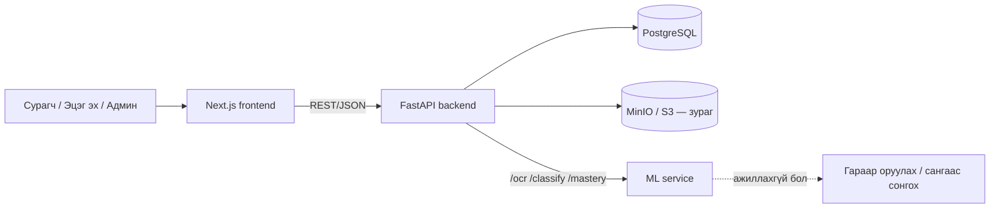

# Архитектур

## Үндсэн хүснэгтүүд (эхний хувилбар)

`users`, `parent_child_links`, `topics`, `topic_prerequisites`, `terms`, `problems`, `hints`,
`solution_steps`, `attempts`, `term_clicks`, `mastery`, `uploads`, `badges`, `user_badges`, `streaks`
